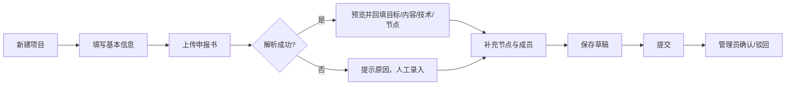
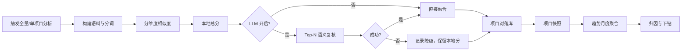
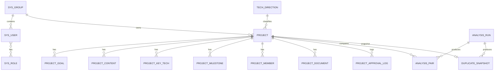

# 自投研发项目重复投入治理平台
## A 阶段产品设计书（核心主线）

| 项 | 内容 |
|----|------|
| 文档版本 | v1.0 |
| 阶段 | A 阶段：结构化申报书 → 多维重复度分析 → 趋势与归因 |
| 状态 | 待评审 |
| 关联任务 | 父任务 `10-29-fund-dup-platform`；子任务 `fund-foundation`、`fund-declaration`、`fund-dup-engine`、`fund-trend-attribution` |
| 技术栈 | Spring Boot 2.7 / MyBatis-Plus / MySQL 8 / H2（演示）/ Vue 3 + TypeScript / Element Plus / ECharts |
| 说明 | 本文件是 A 阶段的产品与交互设计基线；角色管理、系统管理、完整审批流在 governance 阶段，投入态势与辅助决策在 B 阶段 |

---

## 1. 产品概述

### 1.1 要解决的问题

电科太极通过平台基金、创新基金支持各业务部门技术创新。申报材料分散、缺少结构化沉淀，评审只能靠专家逐份翻阅，导致：

- 看不清：项目目标、研制内容、关键技术、节点计划无法跨部门检索。
- 算不清：技术点撞车、研制内容重复只能在立项会上发现，重复投入无法量化。
- 管不住：没有重复度随时间变化的趋势与归因，无法判断问题出在本组还是跨组。

### 1.2 A 阶段产品目标

用一条可演示的闭环回答三个问题：

1. **这个项目在说什么？** 申报书结构化为目标、研制内容、关键技术、节点计划。
2. **它和谁重复、重复多少？** 多维相似度分析给出总分、分维度得分、重复点与差异点。
3. **重复问题在变好还是变坏、来自哪里？** 管理人员看到月度趋势与四类归因（本组内部 / 他组在先 / 我方在先 / 同期并行）。

### 1.3 A 阶段成功标准

| 编号 | 标准 | 验证方式 |
|------|------|----------|
| S1 | 上传一份 docx 申报书，能自动解析并回填至少三类结构化内容 | 现场上传演示 |
| S2 | 一键分析后，项目详情能看到 Top-5 相似项目与重复片段 | 分析报告页 |
| S3 | 重复度趋势至少 6 个月，四类归因可下钻到项目对 | 趋势页 |
| S4 | 相同输入重复分析结果一致，权重调整后得分可复算 | 单元测试 + 现场改权重 |
| S5 | 大模型关闭或调用失败时分析仍成功，并标注降级 | 关闭开关演示 |
| S6 | 演示数据覆盖本组重复、他组在先、我方在先、同期并行 | 趋势归因构成 |

---

## 2. A 阶段范围

### 2.1 包含

- 工程底座：登录、JWT、角色枚举、数据范围钩子、种子项目组/技术方向、审计写入。
- 项目与申报书：项目主数据、目标/研制内容/关键技术/节点计划/成员、附件上传与解析、草稿到提交的最小状态闭环。
- 重复度分析：本地多维算法 + 可选外部大模型语义复核、权重与阈值配置、分析运行、项目对与项目快照。
- 趋势与归因：月度/季度趋势、四类归因、热力图、下钻、结论摘要、CSV 导出。
- 演示数据：12–20 个项目，覆盖四类归因，支撑 A 阶段内部演示。

### 2.2 不包含（后续阶段）

| 内容 | 阶段 |
|------|------|
| 投入态势、重复投入风险敞口 | B |
| 新项目预检、决策建议、Word/Excel 报告 | B |
| 用户/角色/项目组/技术方向管理界面 | C |
| 形式审查、专家评审、完整审批流、待办 | C |
| 审计查询与导出 | C |
| 60 项目完整演示数据、数据库备份、截图、WeCode 部署 | D |

### 2.3 A 阶段边界

- 状态只启用 `DRAFT → SUBMITTED → APPROVED / REJECTED`，由管理员/基金办操作；不实现专家评分与形式审查。
- 角色体系只保证“能登录、有角色、数据范围钩子可用”，不做角色分配界面。
- 附件只解析有文本层的 docx/pdf/txt/md，不做 OCR。
- 大模型默认关闭，只作为可选增强，不依赖外网完成演示。

---

## 3. 用户与场景

### 3.1 A 阶段用户

| 角色 | A 阶段能力 | 说明 |
|------|------------|------|
| 系统管理员 ADMIN | 全部功能、分析配置、分析运行 | 演示主账号，承担所有操作 |
| 基金办 PMO | 查看全部项目、运行分析、看趋势 | 数据范围全所 |
| 项目组用户 GROUP_USER | 维护本组项目、提交、查看本组结果 | 数据范围钩子接入，细粒度权限在 C 阶段完善 |
| 评审专家 EXPERT | A 阶段不启用评审入口 | 仅保留账号与角色 |

演示账号沿用父规划：`admin / Admin@123`、`pmo01 / Pmo@12345`、`user01 / User@12345`。

### 3.2 核心场景

**场景 A：项目组提交申报书**

王工（智能计算组）拿到一份 Word 申报书，登录后新建项目，填写基本信息，上传 docx。系统解析出“项目目标、研制内容、关键技术、节点计划”，王工确认回填、补充节点与成员，保存并提交。

**场景 B：基金办分析重复度**

基金办小李打开分析中心，点击“全量分析”。系统在几秒内给出每个项目的最高重复度、相似项目和片段。小李打开“工业质检多模态缺陷识别”，看到它与数据治理组半年前的项目重复度 86 分，关键技术高度重合，系统归因为“他组在先”。

**场景 C：管理人员看趋势与归因**

小李进入“趋势与归因”，看到近 12 个月平均最高重复度从 48 升到 63，主要增长来自“他组在先”和“同期并行”。他筛选“智能计算组”，发现本组内部重复也在上升，点击 2026-08 的数据点，下钻到具体项目对，看到重复的技术点原文。

**场景 D：调整口径复核**

管理员认为研制内容权重偏低，把内容权重从 35 调到 45、技术从 35 调到 25，重新分析。系统保留历史运行，新运行按新权重复算，报告标注配置版本。

---

## 4. 信息架构

```text
登录
└─ 主框架
   ├─ 工作台（A 阶段占位：核心指标 + 快捷入口）
   ├─ 项目管理
   │  ├─ 项目列表
   │  ├─ 新建/编辑项目（基本信息 / 申报内容 / 节点与成员 / 附件）
   │  └─ 项目详情（概览 / 申报内容 / 节点成员 / 附件 / 审批轨迹 / 重复度）
   ├─ 分析中心
   │  ├─ 分析运行（全量 / 单项目 / 运行历史）
   │  ├─ 分析配置（权重、阈值、Top-K、同期窗口、LLM）
   │  └─ 项目分析报告（相似项目、分维度、重复/差异片段）
   └─ 趋势与归因
      ├─ 趋势总览（折线 + 高风险柱）
      ├─ 归因构成（100% 堆叠）
      ├─ 热力图（组×月 / 方向×组）
      └─ 下钻抽屉（项目列表 → 项目对对比）
```

A 阶段菜单只有：工作台、项目管理、分析中心、趋势与归因。系统管理、决策、投入在后续阶段加入。

---

## 5. 页面设计

### 5.1 全局布局

```text
┌──────────────────────────────────────────────────────────────┐
│ 顶部：产品名 / 当前角色 / 用户菜单                            │
├──────────────┬───────────────────────────────────────────────┤
│ 侧栏          │ 页面标题 + 筛选/操作区                         │
│ 工作台        │ ┌───────────────────────────────────────────┐ │
│ 项目管理      │ │ 内容区（卡片 / 表格 / 图表）               │ │
│ 分析中心      │ │                                           │ │
│ 趋势与归因    │ └───────────────────────────────────────────┘ │
└──────────────┴───────────────────────────────────────────────┘
```

- 侧栏深色（`#0f1b33`），主内容浅灰底（`#f5f7fb`），卡片白色。
- 主色科技蓝 `#1f5eff`，辅助青 `#00c2b8`，风险橙 `#f5a524`，高风险红 `#e5484d`。
- 字号：正文 14，辅助 12，页面标题 20，KPI 28；圆角 6/10；阴影克制。
- 表格行高 48，斑马纹关闭，悬浮高亮；图表使用统一卡片容器。

### 5.2 登录页

- 左侧品牌区：产品名、一句话价值（“把自投项目的重复账算清楚”）、抽象数据纹理。
- 右侧表单：用户名、密码、登录按钮、错误提示、演示账号提示（仅 demo profile）。
- 交互：Enter 提交；失败显示原因；锁定提示剩余时间；登录成功跳转 redirect 或工作台。

### 5.3 工作台（A 阶段）

```text
┌ KPI ────────────────┬ KPI ────────────────┬ KPI ────────────────┐
│ 项目总数 18          │ 平均最高重复度 63.2  │ 高风险项目 4         │
└─────────────────────┴─────────────────────┴─────────────────────┘
┌ 最近一次分析 ────────────────────────┬ 快速入口 ──────────────────┐
│ 时间 / 项目数 / 耗时 / LLM 状态       │ [全量分析] [新建项目]       │
│ [查看报告]                            │ [趋势与归因]                │
└──────────────────────────────────────┴────────────────────────────┘
┌ 高风险项目 Top 5 ────────────────────────────────────────────────┐
│ 项目名 / 组 / 最高分 / 主要归因 / 最近分析时间                    │
└──────────────────────────────────────────────────────────────────┘
```

- 无分析数据时显示引导：“还没有分析结果，先运行一次全量分析”。
- 数字来自最新快照；点击 KPI 跳转对应页面并带筛选。

### 5.4 项目列表

- 筛选：关键词、项目组、基金类型、技术方向、状态、预算区间、重复度区间。
- 工具栏：新建项目、全量分析（管理员）、导出（B 阶段）。
- 列：项目名称/编码、项目组、技术方向、预算、状态、最高重复度（等级色点）、更新时间、操作。
- 交互：行点击进详情；状态标签颜色固定；空态显示“暂无项目，新建第一个项目”。
- 分页：默认 10 条，可切 20/50。

### 5.5 新建/编辑项目

分区纵向表单，左侧锚点导航，右侧内容：

```text
① 基本信息
  名称* / 编码（自动，可改）/ 基金类型* / 项目组* / 负责人*
  技术方向* / 预算* / 起止日期* / 摘要 / 预期成果

② 申报内容
  项目目标*（多条，可增删排序）
  研制内容*（多条）
  关键技术（名称 + 说明 + 难度，可增删排序）

③ 节点与成员
  节点计划*（阶段 / 起止 / 交付物 / 权重）
  项目成员（用户 / 角色 / 投入人月）

④ 申报书附件
  拖拽上传（docx/pdf/txt/md，≤20MB，最多 10 个）
  解析状态 / 解析预览 / 一键回填 / 重新解析 / 下载 / 删除

底部：保存草稿 | 保存并提交
```

- 校验即时反馈；提交时定位到第一个错误字段。
- 离开未保存提示；草稿自动保存可选（手动保存为准）。
- 附件解析预览弹窗：左侧原文分段，右侧识别出的四类内容，勾选“应用到表单”。

### 5.6 项目详情

- 头部：项目名、编码、状态标签、项目组、负责人、预算、最高重复度、操作按钮（提交/撤回/确认/驳回/分析）。
- Tab：
  - 概览：摘要、目标、预期成果、时间线。
  - 申报内容：目标列表、研制内容列表、关键技术卡片。
  - 节点与成员：节点表格（含权重）、成员表。
  - 附件：文件列表、解析状态、下载、重新解析。
  - 审批轨迹：时间线（谁、何时、从什么状态到什么状态、意见）。
  - 重复度：最新快照、Top-5 相似项目、分维度雷达/条、重复/差异片段、跳转完整报告。
- 未分析时重复度 Tab 显示“运行分析后查看”。

### 5.7 分析中心

**运行页**

```text
┌ 分析配置摘要 ─────────────────────────────────────────────┐
│ 权重：目标15 内容35 技术35 节点5 标签10 | 阈值 80/60/40    │
│ LLM：关闭 | TopK 5 | 同期窗口 30 天         [编辑配置]     │
└────────────────────────────────────────────────────────────┘
[全量分析]  [选择项目分析]
┌ 运行历史 ──────────────────────────────────────────────────┐
│ 时间 / 类型 / 项目数 / 项目对数 / 耗时 / LLM / 状态 / 操作  │
└────────────────────────────────────────────────────────────┘
```

- 运行中显示进度态（项目数、已处理数），禁止重复触发全量运行。
- 失败显示原因与重试；运行详情可查看本次配置版本。

**配置页（管理员）**

- 字段权重滑块/数字（五项，自动归一化提示）。
- 阈值：高/中/低（校验 low < medium < high）。
- Top-K、同期窗口天数。
- LLM：开关、Base URL、模型、API Key（脱敏，只写不读）、本地/大模型权重、候选对数、超时。
- 保存前校验；保存后生成新版本，旧运行不受影响。

**项目分析报告**

```text
┌ 项目信息 + 总分层 ────────────────────────────────────────┐
│ 名称 / 组 / 方向 / 预算 / 状态                              │
│ 总分 86.4 [高]  归因：他组在先   分析时间 2026-10-29        │
│ 分维度：目标 72 | 内容 88 | 技术 91 | 节点 40 | 标签 80     │
└───────────────────────────────────────────────────────────┘
┌ Top-5 相似项目 ───────────────────────────────────────────┐
│ 项目 / 组 / 负责人 / 总分 / 主要重合维度 / 归因 / [对比]    │
└───────────────────────────────────────────────────────────┘
┌ 重复点 / 差异点 ──────────────────────────────────────────┐
│ 维度分组，关键词标签 + 原文片段（高亮）                     │
└───────────────────────────────────────────────────────────┘
```

- “对比”打开并排视图：双方四类内容左右对照，重复片段高亮。
- LLM 启用时显示“语义复核理由”；降级时显示“本地算法结果”标签。

### 5.8 趋势与归因

**筛选栏**：时间范围（默认近 12 个月）、粒度（月/季）、项目组、技术方向、基金类型、等级、导出 CSV。

**第一屏**

```text
┌ 结论摘要 ────────────────────────────────────────────────┐
│ 本期平均最高重复度较上期上升 8.2%；主要归因为“他组在先”   │
│ (34%)；重点关注：智能计算组、数据治理组。                  │
└──────────────────────────────────────────────────────────┘
┌ 重复度趋势（折线） + 高风险项目数（柱） ─────────────────┐
│ x=月份  y1=平均最高重复度  y2=高风险项目数                 │
└──────────────────────────────────────────────────────────┘
┌ 归因构成（100% 堆叠柱） ─────────────────────────────────┐
│ 四类颜色固定 + 图例；hover 显示计数与占比                  │
└──────────────────────────────────────────────────────────┘
```

**第二屏**

- 热力图：行=项目组，列=月份，值=平均最高重复度/高风险数（可切换）。
- 维度切换：项目组×月份 / 技术方向×项目组。
- 点击单元格/数据点打开下钻抽屉。

**下钻抽屉**

```text
时间点：2026-08  项目组：智能计算组
┌ 项目列表 ────────────────────────────────────────────────┐
│ 项目 / 方向 / 最高分 / 等级 / 高风险对数 / 归因分布        │
└──────────────────────────────────────────────────────────┘
点击项目 → 项目分析报告
点击项目对 → 双方内容并排 + 分维度分 + 重复/差异片段 + LLM 理由
```

- 筛选条件写入 URL，刷新与分享可复现。
- 空态：“暂无分析数据，先运行一次分析”；加载态用骨架屏。
- 图表 resize 自适应；图表失败时提供表格兜底。

---

## 6. 核心流程

### 6.1 申报与解析



### 6.2 分析与趋势



---

## 7. 功能设计

### 7.1 底座（A1）

| 功能 | 规则 |
|------|------|
| 登录 | 用户名 + 密码；BCrypt；JWT 8 小时；失败 5 次锁定 10 分钟 |
| 当前用户 | 返回用户、角色、项目组、菜单权限 |
| 字典 | 基金类型、项目状态、角色、技术方向只读 |
| 种子 | 8 个项目组、12 个技术方向、4 个角色、4 个账号 |
| 数据范围 | 提供 `DataScopeService` 钩子；A 阶段管理员看全部 |
| 审计 | 登录、密码修改、后续业务写操作写 `audit_log`，敏感字段脱敏 |
| 健康检查 | `/api/v1/health` 返回应用、profile、数据库状态 |

### 7.2 项目与申报书（A2）

| 对象 | 字段/规则 |
|------|-----------|
| 项目 | 名称、编码（`TJJH-{年}-{4位}`，唯一）、基金类型、项目组、负责人、技术方向、预算（>0）、起止日期、摘要、预期成果 |
| 目标 | 多条文本、排序、至少 1 条 |
| 研制内容 | 多条文本、排序、至少 1 条 |
| 关键技术 | 名称、说明、难度（高/中/低）、排序，可 0 条 |
| 节点计划 | 阶段名、计划起止、交付物、权重（0–100）、排序、至少 1 条 |
| 成员 | 用户、角色（负责人/核心/参与）、投入人月（>0） |
| 附件 | docx/pdf/txt/md，≤20MB，≤10 个；解析状态 PENDING/PARSED/FAILED |
| 状态 | 首版：DRAFT、SUBMITTED、APPROVED、REJECTED；提交后只读，撤回可改 |
| 提交校验 | 必填、目标/内容/节点、预算、日期合法；首次提交写 `submit_time` |

**附件解析规则**

- docx 用 POI 提取段落；pdf 用 PDFBox（按位置排序）；txt/md 按 UTF-8 读取。
- 章节关键词：项目目标、研究目标、总体目标、研制内容、研究内容、关键技术、节点计划、进度安排、实施计划、考核指标。
- 识别失败时，整体正文作为“研制内容”候选并提示人工确认。
- 清洗：去 BOM/HTML/控制符、统一换行、压缩空行、截断 200,000 字符。
- 安全：扩展名 + 文件头校验；存储名使用 UUID；下载按 ID，不接受路径。

### 7.3 重复度分析（A3）

**输入**

- 目标文本、研制内容、关键技术（名称+说明）、节点（阶段+交付物+日期）、技术方向与关键技术标签。
- 结构化字段缺失时回退附件正文。

**输出**

- 项目对：分维度分、本地分、LLM 分、总分、等级、归因、在先项目、重复点、差异点。
- 项目快照：最高分、Top-K 平均分、高风险对数、四类归因计数、风险敞口（B 阶段使用）。

**配置**

- 字段权重默认 15/35/35/5/10；等级阈值 80/60/40；Top-K 5；同期窗口 30 天。
- LLM 开关、本地/大模型权重 70/30、候选对数 5、超时 8s。
- 配置版本化；保存需通过校验；变更写审计。

**运行规则**

- 触发方式：全量、单项目、预检（B 阶段）。
- 同时只允许一个全量/单项目运行；重复触发复用或提示。
- 只落 `总分 ≥ 低阈值` 的对，且每项目保留 Top-K。
- 运行失败清理本次结果，不影响历史；成功更新项目最新分数。
- 历史趋势回填为管理员能力（D 阶段生成演示数据时使用）。

### 7.4 趋势与归因（A4）

**指标**

| 指标 | 定义 |
|------|------|
| 分析项目数 | 当月有快照的项目数（同项目同月取最新运行） |
| 平均最高重复度 | 快照 `max_score` 的算术平均 |
| Top-K 平均分 | 快照 `avg_top_score` 的平均 |
| 高风险项目数 | `max_score ≥ 高阈值` 的项目数 |
| 项目对数 | 参与统计的项目对数量（过滤后） |
| 四类归因 | 本组内部 / 他组在先 / 我方在先 / 同期并行 |
| 环比 | 与上一时间点比较的变化率；基数为 0 时为空 |

**归因判定**

- 同组：`SELF_GROUP`。
- 跨组：申报时间差 ≤ 30 天 → `SIMULTANEOUS`；否则较早项目为“在先”，查看项目为较早方 → `OUR_EARLIER`，否则 `PEER_EARLIER`。
- 数据库存中性 `earlier_project_id`，展示层按查看项目解释为我方/他方。
- 趋势按项目视角统计：跨组对在双方项目组各计一次，页面与导出注明口径。

**结论摘要规则**

- 不足 2 个时间点：提示数据不足。
- 变化 >1 分：上升/下降；否则基本持平。
- 主归因取计数最大的一类。
- 重点关注组取高风险数或跨组重复数 Top 2。

---

## 8. 数据设计

### 8.1 ER 关系



### 8.2 核心表

| 表 | 关键字段 | 说明 |
|----|----------|------|
| `sys_group` | id, name, code, parent_id, enabled | 项目组/部门树 |
| `sys_user` | id, username, password_hash, real_name, group_id, status | 用户 |
| `sys_role` / `sys_user_role` | id, code / user_id, role_id | 角色 |
| `tech_direction` | id, name, keywords, parent_id, enabled | 技术方向与关键词 |
| `project` | id, code, name, fund_type, group_id, owner_id, tech_direction_id, budget, start_date, end_date, status, submit_time, duplicate_score | 项目主表 |
| `project_goal` / `project_content` | project_id, content, sort | 目标/研制内容 |
| `project_key_tech` | project_id, name, description, difficulty, sort | 关键技术 |
| `project_milestone` | project_id, name, plan_start, plan_end, deliverable, weight | 节点 |
| `project_member` | project_id, user_id, member_role, workload | 成员 |
| `project_document` | project_id, file_name, storage_path, text_content, parse_status | 附件与正文 |
| `project_approval_log` | project_id, from_status, to_status, action, operator_id, comment | 轨迹 |
| `analysis_config` | version, field_weights, thresholds, top_k, simultaneous_days, llm_enabled, local_weight, llm_weight | 配置 |
| `analysis_run` | trigger_type, project_id, config_version, analysis_date, status, project_count, pair_count, llm_used, duration_ms | 运行 |
| `analysis_pair` | run_id, project_id, peer_project_id, 五维分, local_score, llm_score, total_score, level, relation, direction, earlier_project_id, matched_points, diff_points | 项目对 |
| `duplicate_snapshot` | run_id, project_id, group_id, analysis_date, max_score, avg_top_score, high_pair_count, 四类归因计数, risk_exposure | 项目快照 |
| `audit_log` | user_id, action, resource_type, resource_id, detail, ip, result | 审计 |
| `llm_call_log` | run_id, project_id, peer_project_id, model, status, latency_ms, tokens, error | LLM 调用 |

### 8.3 约定

- 主键 BIGINT 自增；逻辑删除；时间在应用层写入。
- JSON 结构存 TEXT，避免 MySQL/H2 方言差异。
- 金额 DECIMAL(14,2)，分数 DECIMAL(5,2)。
- Flyway 只增不改；V1 系统表、V2 种子、V3 项目、V4 分析、V5 决策（B）、V6 治理（C）。
- 索引：`project(code)` 唯一、`project(group_id,status)`、`analysis_pair(run_id,project_id,total_score)`、`duplicate_snapshot(group_id,analysis_date)`。

---

## 9. 接口设计

### 9.1 约定

- 前缀 `/api/v1`；`Authorization: Bearer <token>`。
- 响应：`{"code":0,"message":"ok","data":{},"traceId":"..."}`。
- 分页：`{"records":[],"total":0,"page":1,"size":10,"pages":0}`。
- 错误码：400xx 参数/状态，401xx 认证，403xx 权限，404xx 不存在，500xx 系统。

### 9.2 A 阶段接口清单

| 模块 | 方法与路径 | 说明 |
|------|------------|------|
| 认证 | `POST /auth/login` | 登录 |
| 认证 | `GET /auth/me`、`PUT /auth/password`、`POST /auth/logout` | 当前用户/改密/登出 |
| 字典 | `GET /dicts`、`GET /groups`、`GET /tech-directions` | 只读 |
| 项目 | `GET /projects`、`POST /projects`、`GET /projects/{id}`、`PUT /projects/{id}`、`DELETE /projects/{id}` | 列表/新建/详情/更新/删草稿 |
| 申报内容 | `PUT /projects/{id}/sections` | 批量保存五类内容 |
| 状态 | `POST /projects/{id}/actions` | `submit/withdraw/approve/reject` |
| 轨迹 | `GET /projects/{id}/logs` | 审批轨迹 |
| 附件 | `POST /projects/{id}/documents` | 上传并解析 |
| 附件 | `GET /documents/{id}/download`、`POST /documents/{id}/parse`、`DELETE /documents/{id}` | 下载/重解析/删除 |
| 附件 | `GET /projects/{id}/documents/{docId}/sections` | 解析预览 |
| 分析 | `GET /analysis/config`、`PUT /analysis/config`、`GET /analysis/config/history` | 配置 |
| 分析 | `POST /analysis/runs`、`GET /analysis/runs`、`GET /analysis/runs/{id}` | 运行 |
| 分析 | `GET /analysis/projects/{id}`、`GET /analysis/pairs/{id}` | 报告/对明细 |
| 趋势 | `GET /insight/trend`、`GET /insight/attribution`、`GET /insight/heatmap`、`GET /insight/trend/projects`、`GET /insight/trend/export` | 趋势归因 |

### 9.3 示例

**创建项目**

```json
POST /api/v1/projects
{
  "name": "面向工业质检的多模态缺陷识别",
  "fundType": "PLATFORM",
  "groupId": 1,
  "ownerId": 3,
  "techDirectionId": 1,
  "budget": 1200000.00,
  "startDate": "2026-11-01",
  "endDate": "2027-10-31",
  "summary": "面向精密制造缺陷检测...",
  "expectedOutcome": "形成一套可复用的多模态质检平台"
}
```

**分析报告**

```json
GET /api/v1/analysis/projects/1
{
  "code": 0, "message": "ok",
  "data": {
    "project": {"id": 1, "name": "...", "groupName": "智能计算组"},
    "snapshot": {"maxScore": 86.4, "level": "HIGH", "analysisDate": "2026-10-29"},
    "scores": {"goal": 72.1, "content": 88.3, "tech": 91.0, "milestone": 40.0, "tag": 80.0},
    "topPeers": [{
      "pairId": 12, "peer": {"id": 7, "name": "...", "groupName": "数据治理组"},
      "totalScore": 86.4, "level": "HIGH",
      "relation": "CROSS_GROUP", "direction": "PEER_EARLIER",
      "matchedPoints": [{"dimension": "tech", "terms": ["多模态","缺陷检测"], "snippet": "..."}],
      "diffPoints": [{"dimension": "goal", "terms": ["轻量化部署"], "snippet": "..."}]
    }]
  }
}
```

**趋势**

```json
GET /api/v1/insight/trend?startMonth=2025-11&endMonth=2026-10&granularity=MONTH
{
  "hasData": true,
  "points": [{
    "period": "2026-08",
    "analyzedProjectCount": 18,
    "avgMaxScore": 63.2,
    "highRiskCount": 4,
    "pairCount": 41,
    "attribution": {"selfGroup": 12, "peerEarlier": 9, "ourEarlier": 7, "simultaneous": 13},
    "ratios": {"selfGroup": 0.29, "peerEarlier": 0.22, "ourEarlier": 0.17, "simultaneous": 0.32},
    "mom": {"avgMaxScore": 0.082}
  }],
  "summary": ["本期平均最高重复度较上期上升 8.2%..."]
}
```

---

## 10. 算法与口径

### 10.1 文本处理

1. 归一化：全角转半角、去 HTML/控制符、统一空白、英文小写、去页眉页脚噪声。
2. 分词：中文字符 2-gram + 英文/数字词 + 术语词典命中词（权重 ×3）。
3. 过滤停用词与纯标点；空文本维度记 0 并标注。

### 10.2 相似度

| 维度 | 计算 | 默认权重 |
|------|------|----------|
| 项目目标 | TF-IDF 余弦 ×100 | 15 |
| 研制内容 | TF-IDF 余弦 ×100 | 35 |
| 关键技术 | 名称+说明 TF-IDF 余弦 ×100 | 35 |
| 节点计划 | 阶段名 Jaccard×60% + 时间重叠率×40%，×100 | 5 |
| 技术标签 | 技术方向+技术名称 Jaccard ×100 | 10 |

```text
localScore = Σ(维度分 × 权重) / Σ(权重)
level = ≥80 高；≥60 中；≥40 低；否则无明显重复
```

- TF-IDF：`tf = 1 + ln(count)`，`idf = ln((N+1)/(df+1)) + 1`，L2 归一化。
- 相同输入 + 相同配置 → 相同结果；不使用随机数。

### 10.3 大模型融合

```text
if 未开启/未配置: 只用本地分
candidates = 本地分 Top-N
for each:
  调用 OpenAI 兼容 /chat/completions，temperature=0，要求 JSON
  校验 semanticScore∈[0,100]、overlaps/differences 数组、suggestion 枚举
  成功: total = (本地权重×本地分 + 大模型权重×语义分)/(权重和)
  失败: 保留本地分；连续 3 次失败 → 本次运行停止调用
```

- 默认关闭；超时 8s；并发 2；缓存 24h；熔断仅单次运行内。
- 日志只记状态、耗时、token，不记 prompt 正文与 API Key。
- 报告标注“本地算法结果”或“本地+语义复核”。

### 10.4 归因与趋势

```text
同组 → SELF_GROUP
跨组且 |Δt| ≤ 30 天 → SIMULTANEOUS
跨组且 Δt > 30 天 → 较早方为在先；查看方=较早方 → OUR_EARLIER，否则 PEER_EARLIER
```

- 存储中性事实，展示按视角解释。
- 趋势按分析日期月份聚合；同项目同月取 `run_id` 最大的一条。
- 跨组对在双方视角各计一次，页面与导出注明“项目视角”。

---

## 11. 权限与安全

### 11.1 A 阶段权限

| 能力 | ADMIN | PMO | GROUP_USER | EXPERT |
|------|-------|-----|------------|--------|
| 登录/工作台 | 是 | 是 | 是 | 是 |
| 项目查看 | 全部 | 全部 | 本组 | 暂不启用 |
| 项目编辑/提交 | 是 | 是 | 本组草稿 | 否 |
| 项目确认/驳回 | 是 | 是 | 否 | 否 |
| 分析运行/配置 | 是 | 运行（配置按需） | 否 | 否 |
| 趋势归因 | 全部 | 全部 | 本组 | 否 |

- A 阶段以后端 `@PreAuthorize` + 数据范围钩子为准；前端仅隐藏入口。
- 完整矩阵在 C 阶段补齐并逐项测试。

### 11.2 安全

- 密码 BCrypt（strength 10）；登录失败锁定；JWT HS256，密钥 ≥32 字节。
- 上传扩展名 + 文件头校验；存储目录不在 Web 根；下载只接受 ID。
- SQL 全参数绑定；排序字段白名单；输出转义，用户内容不使用 `v-html`。
- 审计脱敏：密码、Token、API Key 不落库、不写日志。
- 生产密钥只来自环境变量；仓库不提交 `.env`。

---

## 12. 非功能设计

| 类别 | A 阶段要求 |
|------|------------|
| 性能 | 列表/详情 P95 ≤1s；单项目分析 ≤2s；300 项目全量 ≤5s（本地算法） |
| 稳定性 | 分析失败不影响项目数据；LLM 异常自动降级；事务覆盖多表写入 |
| 可用性 | 中文界面；加载/空态/错误态完整；关键操作二次确认；1440×900 起适配 |
| 可维护性 | 后端按 feature 分包；前端按模块组织；OpenAPI 文档；核心算法单测 |
| 可部署性 | H2 一条命令启动；MySQL 生产配置；Flyway 自动建表 |
| 可追溯 | 审批轨迹、分析运行、配置版本、审计日志全部留痕 |

---

## 13. 验收标准（A 阶段）

| 编号 | 验收项 | 验证方式 |
|------|--------|----------|
| AC-A1 | 应用 demo 模式启动，admin 登录成功，种子组/技术方向/字典可用 | 启动 + 登录 |
| AC-A2 | 创建项目并完整填写目标/内容/技术/节点/成员，刷新不丢失 | 页面操作 |
| AC-A3 | 上传 docx 后解析并回填至少目标/内容/技术三类 | 上传演示 |
| AC-A4 | pdf/txt/md 均可解析；超限/非法类型被拒；失败有原因 | 四种样例 |
| AC-A5 | 提交前缺必填项被拦截；提交后只读；撤回可再编辑 | 流程走查 |
| AC-A6 | 全量分析成功，项目报告显示 Top-5、五维分、重复/差异片段 | 分析演示 |
| AC-A7 | 相同文本夹具 ≥95，无关 <30，部分重叠落在 40–80 | 单元测试 |
| AC-A8 | 修改权重后重跑，结果按新权重复算；关闭 LLM 仍成功 | 现场改配置 |
| AC-A9 | 模拟 LLM 超时/非法响应，运行成功且 `llmUsed=false` | 故障注入 |
| AC-A10 | 趋势 ≥6 个月，四类归因与项目对明细一致；筛选联动 | 页面 + 对账 |
| AC-A11 | 同项目同月多次分析只计一次；跨组对按视角计一次有说明 | 数据核对 |
| AC-A12 | 点击趋势点可下钻到项目列表与项目对；URL 可复现 | 页面操作 |
| AC-A13 | `mvn test`、`npm run build` 通过；无硬编码密钥 | 命令行 |

---

## 14. A 阶段演示脚本（约 3 分钟）

1. **0:00–0:20 背景**：自投项目逐年累积，重复投入靠专家翻材料发现。
2. **0:20–1:00 申报书结构化**：新建项目 → 上传 docx → 解析预览 → 一键回填 → 补充节点 → 提交。
3. **1:00–1:40 重复度分析**：全量分析 → 打开高风险项目 → 五维分、Top-5、重复技术点、差异点；说明“他组在先”。
4. **1:40–2:30 趋势与归因**：近 12 个月折线、四类归因堆叠、筛选智能计算组、下钻项目对。
5. **2:30–2:50 口径与降级**：修改权重重跑；关闭 LLM 仍出结果；说明可解释与可降级。
6. **2:50–3:00 收尾**：A 阶段完成核心闭环，B 阶段补投入与决策，C 阶段补角色与审批。

---

## 15. 里程碑与风险

### 15.1 里程碑

| 里程碑 | 完成标志 |
|--------|----------|
| M1 底座可用 | 启动、登录、种子、审计写入、前端壳 |
| M2 申报书可用 | 结构化表单 + 四格式解析 + 提交闭环 |
| M3 分析可用 | 全量运行 + 项目报告 + 配置生效 + 降级 |
| M4 趋势可用 | 6+ 月趋势 + 四类归因 + 下钻 + 导出 |
| M5 核心演示 | 按脚本 3 分钟走通，数据可复算 |

### 15.2 风险与应对

| 风险 | 应对 |
|------|------|
| 中文相似度对同义改写不敏感 | 术语词典 + 可选 LLM 语义复核；报告中说明双口径 |
| Maven 3.5/JDK 8 依赖兼容 | 一次性锁版本；失败降级 Boot 2.6.15 |
| H2/MySQL DDL 差异 | 只用共同语法；避免 JSON/全文索引/存储过程 |
| 趋势口径被质疑 | 以 `analysis_pair` 为事实源；页面与导出写明“项目视角” |
| LLM 不稳定 | 默认关闭、超时、熔断、缓存、降级标记 |
| 图表运行时空白 | 统一 ChartContainer + resize + 表格兜底 |
| A 阶段数据不足 | 12–20 个演示项目覆盖四类归因；D 阶段扩到 60 |

---

## 附录 A：术语

| 术语 | 含义 |
|------|------|
| 重复度 | 两个项目申报内容的多维加权相似度，0–100 |
| 项目对 | 一次分析中两个项目的比较结果 |
| 快照 | 某项目在某次运行中的项目级聚合结果 |
| 归因 | 重复来源分类：本组内部/他组在先/我方在先/同期并行 |
| 风险敞口 | 预算 × 重复度/100，B 阶段启用 |
| 降级 | LLM 不可用时回退为纯本地算法 |

## 附录 B：枚举与状态

```text
ProjectStatus: DRAFT | SUBMITTED | REVIEWING* | APPROVED | REJECTED
               | IN_PROGRESS* | COMPLETED* | TERMINATED*
  * A 阶段不启用 / 仅保留枚举

FundType: PLATFORM | INNOVATION | OTHER
Difficulty: HIGH | MEDIUM | LOW
ParseStatus: PENDING | PARSED | FAILED
Level: HIGH | MEDIUM | LOW | NONE
Relation: SELF_GROUP | CROSS_GROUP
Direction(存储): A_EARLIER | B_EARLIER | SIMULTANEOUS | SELF_GROUP
Direction(展示): SELF_GROUP | PEER_EARLIER | OUR_EARLIER | SIMULTANEOUS
TriggerType: FULL | PROJECT | PRECHECK
```

## 附录 C：默认配置

```json
{
  "fieldWeights": {"goal": 15, "content": 35, "tech": 35, "milestone": 5, "tag": 10},
  "thresholds": {"high": 80, "medium": 60, "low": 40},
  "topK": 5,
  "simultaneousDays": 30,
  "llm": {"enabled": false, "localWeight": 70, "llmWeight": 30, "topN": 5, "timeoutMs": 8000}
}
```
